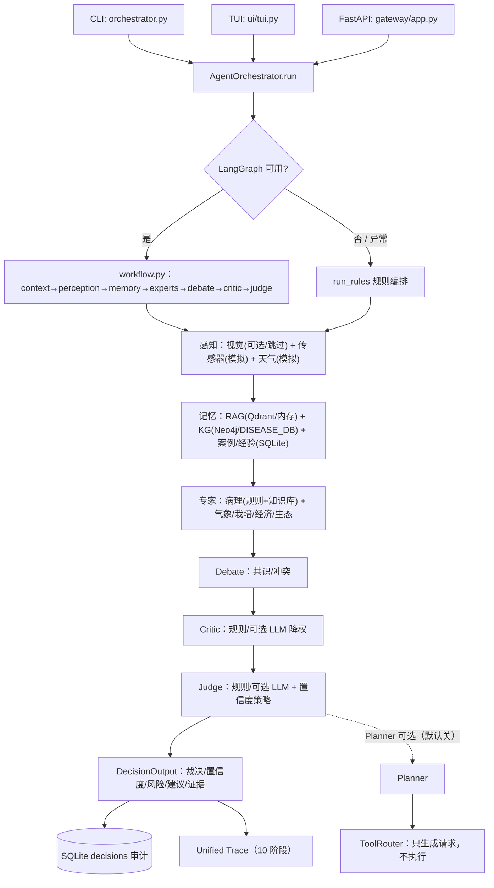

# ACIS — 农业病害诊断与决策支持原型

ACIS（Agricultural Cognitive Intelligence System）是一个面向温室作物病害咨询的
**多阶段 AI 系统工程原型**：把一次自然语言问诊拆成
“感知 → 记忆 → 专家 → 辩论 → Critic → Judge → 审计”的可追溯流程，
输出诊断、置信度、风险等级、行动建议与证据链。默认使用规则裁决，可选接入
OpenAI-compatible LLM；外部模型不可用时自动回退规则链路。

> 本项目是单机、离线可运行的工程原型，不是生产系统，也没有经过真实田间验证。
> 传感器/天气为模拟数据，图片识别默认 mock；这些边界在本文中逐项标明。

## 1. 解决的问题

温室/大棚种植者在病害早期缺少“可解释、可追溯”的诊断建议：单一模型输出往往
无法说明依据了哪些环境、知识库或历史案例证据，也不清楚何时应弃权或转人工。

ACIS 将问诊拆成可审计的多阶段流程，输出：

- 首选病害 + 置信度 + 风险等级；
- 是否建议人工复核；
- 6 条左右的行动建议；
- 辩论共识/冲突、知识图谱校验、推理摘要；
- 可导出的 10 阶段 Trace 与 SQLite 决策审计记录。

覆盖 4 种作物、7 类病害知识（番茄叶霉病/早疫病，黄瓜霜霉病，甜菜褐斑病/根腐病，
棉花黄萎病/枯萎病）；黄瓜保留兼容。

## 2. 实现边界：真实 / 模拟 / 可选 / 未实现

| 类别 | 当前实现 |
|---|---|
| **真实实现** | LangGraph 主图与规则回退编排；感知/记忆/专家/Debate/Critic/Judge 分层；RAG（Qdrant 优先、内存回退）；知识图谱（Neo4j 优先、内置 `DISEASE_DB` 回退）；SQLite 决策/反馈/结果存储；统一 Trace（10 阶段）；CLI/TUI/FastAPI 三入口；规则裁决与失败回退。 |
| **模拟数据** | 传感器读数与异常检测输入为确定性模拟；天气为模拟/随机生成；不是真实 IoT 或气象接入。 |
| **mock / 可选模型** | 图片识别默认 mock（可选 transformers 模型，但真实视觉效果**未验证**，离线不下载模型）；LLM Judge/Critic 为可选增强，需要 API key，规则路径不依赖。 |
| **可选/默认关闭** | Planner 默认关闭（`ACIS_ENABLE_PLANNER=0`）；开启后只生成计划，不自动执行。 |
| **未实现/未验证** | 工具执行（ToolRouter 只生成请求，不执行施药/灌溉）；真实田间/生产并发/SLA；Docker 镜像未在本环境验证；真实 LLM 质量只做过单次连通性验证；普通 Windows 环境的全量测试未复跑。 |

## 3. 架构与数据流



关键数据流：`用户输入 → 上下文解析 → 感知/记忆/专家证据 → Debate/Critic → Judge →
决策落库 + Trace → CLI/API 输出`。`need_human_review` 在低置信、专家冲突、Critic
升级、KG 硬约束冲突时置真；反馈/结果通过 API 回灌到 SQLite，供后续案例/经验召回。

## 4. 快速开始

环境：Python 3.13（开发环境 3.13.3），Windows/Linux 均可；无 Neo4j/Qdrant/API key
也可运行核心文本链路。

```powershell
python -m venv .venv
.\.venv\Scripts\Activate.ps1
pip install -r requirements.txt
Copy-Item .env.example .env   # 可选；不填 key 时自动走规则
$env:PYTHONIOENCODING='utf-8'; $env:PYTHONPATH='.'
python orchestrator.py --rules-only --seed 7 "温室A番茄叶片出现黄斑，叶背有灰色霉层，如何处理？"
```

- `--rules-only`：跳过 LangGraph，直接规则编排；`--seed` 固定模拟层随机部分；
- `--trace-out logs/trace.json`：导出 10 阶段 Trace；`--json` 输出结构化结果；
- TUI：`python -m ui.tui`（6 个演示场景，离线可跑）；
- API：`uvicorn gateway.app:app --port 8000`，`GET /health`、`POST /diagnose`；
- LLM Judge/Critic：设置 `AGRI_AI_JUDGE_*`（或 `DEEPSEEK_API_KEY` 等兼容变量），
  无 key/网络失败自动回退规则，并在 `judge_runtime.fallback_reason_code` 记录原因。

依赖锁 `requirements-lock.txt` 由 **Windows + Python 3.13.3 + 当前 `.venv`** 的
`pip freeze` 生成，包含平台相关包；它不是跨平台锁，其他平台请用 `requirements.txt`
重新解析。`.env.example` 是配置模板，不包含真实密钥。

## 5. 测试与评测

| 项目 | 结果 | 说明 |
|---|---|---|
| 测试套件 | 24 个测试文件 / **343 个用例** | 这是用例总数，不等于全部通过 |
| 交付契约测试 | **12 passed** | 正常流程、LangGraph/LLM/持久化回退、Trace、视觉解析、API |
| 受限沙箱全量 | **340 passed / 3 failed** | 3 个失败均为沙箱禁止子进程管道（`test_experiments.py` 调 git），非业务断言失败 |
| 沙箱原样全量 | 286 passed / 1 failed / 56 errors | 56 个 error 来自沙箱 `tmp_path` ACL；普通环境未复跑，不能声称全绿 |
| smoke / fixture | smoke exit 0；fixture **12/12** | 固定场景回归 |
| 离线交付评测 | **12/12** 命中，2 例 Critic，平均置信度 0.6583；两次运行 SHA256 一致 | `scripts/run_delivery_eval.py`，零 API |
| 真实 LLM 单次调用 | 成功：34.56s、10,354 tokens | 仅连通性验证，不是质量评测；规则路径默认不需要 |

**实验证据摘要（详见 `reports/experiment_audit_20261024.md`）**

- Phase 6 baseline（seed42，24 例 × C0/C1/C2，真实 Judge）：72/72 次调用成功、0 回退；
  label accuracy：**C0 20/24、C1 19/24、C2 24/24**。单 seed、n=24，**不能证明完整架构
  优于裸基线**，也不能据此宣称“关记忆更好”。
- 自一致性（C1）：seed42 仅 13/24 可评（11 次连接失败回退），seed43 24/24；
  ECE 约 0.071–0.077、corr 0.538–0.778（基于 trace 中的 agreement），
  只是 C1 两个 seed 的描述性结果，不是普遍校准结论。
- Phase 4.2-R：216 次真实链路调用中 **191 次规则回退**；服务仍可用，但该条件不能
  用于评价模型效果。
- **历史报告中的 `accuracy` 需注意口径**：`reports/archive/phase4/phase4_evaluation_pilot.md`、
  Phase 4.2-R/R3 稳定性报告中的 “accuracy” 在原始报告中指 **factor coverage**
  （因子覆盖度），不是诊断准确率；`scripts/generate_stability_report.py:66-75`
  有明确映射。引用前请先读实验审计。

## 6. 已知限制

- 传感器/天气为模拟；图片识别默认 mock，真实视觉模型未验证；
- 规则 Judge 是默认路径，LLM Judge/Critic 可选且真实质量未做多 seed 评测；
- Phase 6/Phase 4.2 实验为单 seed 或少量有效样本，不能外推为泛化能力；
- 工具执行、Web UI、MCP 服务、Docker 部署未验证/未纳入 MVP；
- 受限沙箱中的 3 个测试失败是环境限制，普通环境尚未复跑；
- 没有真实田间数据、用户规模或生产运维经验。

## 7. 文档导航

| 文档 | 内容 |
|---|---|
| [docs/DEMO_RUNBOOK.md](docs/DEMO_RUNBOOK.md) | 3–5 分钟演示流程与故障注入 |
| [docs/ARCHITECTURE_DECISIONS.md](docs/ARCHITECTURE_DECISIONS.md) | ADR-005 等仍有效的技术决策 |
| [docs/rfc/RFC001-System Architecture.md](docs/rfc/RFC001-System%20Architecture.md) | 完整架构规格（实现子集见上文边界） |
| [reports/experiment_audit_20261024.md](reports/experiment_audit_20261024.md) | C0/C1/C2 实验与指标口径审计 |
| [reports/acceptance_20261024.md](reports/acceptance_20261024.md) | 端到端验收记录与限制 |
| [reports/delivery_eval/summary.md](reports/delivery_eval/summary.md) | 12 例固定离线评测结果 |
| [docs/archive/](docs/archive/) | 历史 Sprint/RFC/状态文档（非当前事实源） |

## 8. 许可证

见 [LICENSE](LICENSE)。
