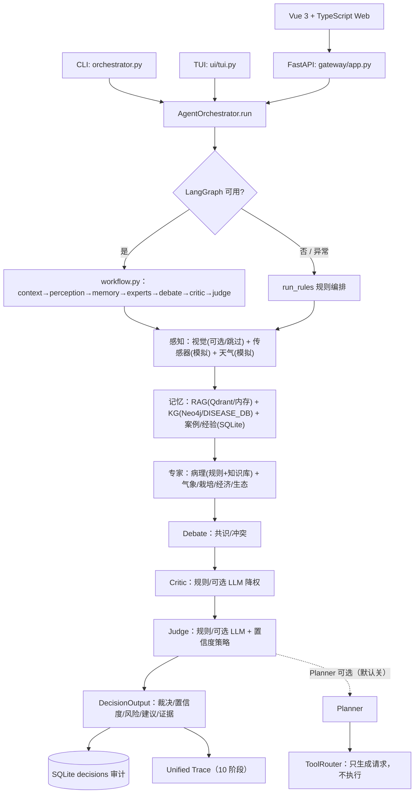

# ACIS · 农业智能诊断工作台

> Vue 3 + TypeScript · FastAPI · RAG/KG · Rich TUI
> 农业问题输入 → 知识检索 → 决策评估 → 诊断报告与全过程 Trace

ACIS（Agricultural Cognitive Intelligence System）是一个面向温室作物病害咨询的
**多阶段 AI 系统工程原型**：把一次自然语言问诊拆成
“感知 → 记忆 → 专家 → 辩论 → Critic → Judge → 审计”的可追溯流程，
输出诊断、置信度、风险等级、行动建议与证据链。默认使用规则裁决，可选接入
OpenAI-compatible LLM；外部模型不可用时自动回退规则链路。Web 端采用 Vue 3 + TypeScript，开发时由 Vite 提供服务，生产环境由 FastAPI 同源托管静态构建产物。

> 本项目是单机、离线可运行的工程原型，不是生产系统，也没有经过真实田间验证。
> 传感器/天气为模拟数据，图片识别默认 mock；这些边界在本文中逐项标明。

## 1. 解决的问题

温室/大棚种植者在病害早期缺少“可解释、可追溯”的诊断建议：单一模型输出往往
无法说明依据了哪些环境、知识库或历史案例证据，也不清楚何时应弃权或转人工。

ACIS 将问诊拆成可审计的多阶段流程，输出：

- 首选病害 + 置信度 + 风险等级；
- 是否建议人工复核；
- 6 条左右的行动建议；
- 辩论共识/冲突、知识图谱校验、推理摘要；
- 可导出的 10 阶段 Trace 与 SQLite 决策审计记录。

覆盖 4 种作物、7 类病害知识（番茄叶霉病/早疫病，黄瓜霜霉病，甜菜褐斑病/根腐病，
棉花黄萎病/枯萎病）；黄瓜保留兼容。

## 2. 实现边界：真实 / 模拟 / 可选 / 未实现

| 类别 | 当前实现 |
|---|---|
| **真实实现** | LangGraph 主图与规则回退编排；感知/记忆/专家/Debate/Critic/Judge 分层；RAG（Qdrant 优先、内存回退）；知识图谱（Neo4j 优先、内置 `DISEASE_DB` 回退）；SQLite 决策/反馈/结果存储；统一 Trace（10 阶段）；CLI、Rich TUI、FastAPI 与 Vue Web 共用诊断服务；规则裁决与失败回退。 |
| **模拟数据** | 传感器读数与异常检测输入为确定性模拟；天气为模拟/随机生成；不是真实 IoT 或气象接入。 |
| **mock / 可选模型** | 图片识别默认 mock（可选 transformers 模型，但真实视觉效果**未验证**，离线不下载模型）；LLM Judge/Critic 为可选增强，需要 API key，规则路径不依赖。 |
| **可选/默认关闭** | Planner 默认关闭（`ACIS_ENABLE_PLANNER=0`）；开启后只生成计划，不自动执行。 |
| **未实现/未验证** | 工具执行（ToolRouter 只生成请求，不执行施药/灌溉）；真实田间/生产并发/SLA；真实 LLM 质量只做过单次连通性验证。Docker 本地验收结果及知识库为空时的回退边界见第 8 节。 |

## 3. 架构与数据流



关键数据流：`用户输入 → 上下文解析 → 感知/记忆/专家证据 → Debate/Critic → Judge →
决策落库 + Trace → CLI/API 输出`。`need_human_review` 在低置信、专家冲突、Critic
升级、KG 硬约束冲突时置真；反馈/结果通过 API 回灌到 SQLite，供后续案例/经验召回。

## 4. 技术栈

依赖与实现位置均可在仓库中核对（`requirements.txt`、对应源码行号）。

| 层 | 选型 |
|---|---|
| 语言 / 运行时 | Python 3.13（开发环境 3.13.3）；Windows 与 Linux 均可运行核心文本链路 |
| 工作流编排 | LangGraph `StateGraph`（`workflow.py:37`），异常时自动回退自研规则编排（`orchestrator.py:172`） |
| API | FastAPI + uvicorn + pydantic（`gateway/app.py:25`） |
| 模型接入 | OpenAI-compatible（`openai` SDK）；Judge/Critic 可选，无 key 自动回退规则 |
| 检索 / 知识 | Qdrant 优先 + 内存回退；Neo4j 优先 + 内置 `DISEASE_DB` 回退 |
| 持久化 | SQLite（标准库 `sqlite3`，`storage/db.py`） |
| 终端 UI | Rich（`ui/tui.py`） |
| Web UI | Vue 3 + Vite + TypeScript；Vitest + vue-tsc |
| 测试 | pytest（27 个测试文件、366 个收集项；见第 8 节实际结果） |
| 可选 Python 依赖 | transformers/torch（视觉可选路径）、scikit-learn（异常检测基线）；不参与 Vue 构建 |

## 5. 核心工程实现

本项目重点不是堆叠 Agent 名称，而是下面几处可核对的工程决策：

1. **工作流编排与规则回退**：LangGraph 主图抛错或不可用时回退 `run_rules`（`orchestrator.py:172-178`），`--rules-only` 可强制跳过；两条路径共享同一输出契约，回退对调用方透明。
2. **LLM 故障分类与留痕**：`agents/judge_agent.py:73` 记录 `fallback_reason_code`（连接失败 / 超时 / 非 JSON / 5xx 等），`:142` 在缺失证据里标注回退原因，`:146` 打印脱敏日志（不输出 key）；回退后 `judge_mode=rules`，不与真实模型结果混淆。
3. **统一 10 阶段 Trace**：`trace/types.py:36-47` 定义固定阶段序列（request → … → metrics），`trace/exporter.py:37` 导出 JSON；CLI `--trace-out` 一条命令产出。
4. **SQLite 决策审计**：`storage/db.py:16` 的 `decisions` 表记录裁决、置信度、风险、`judge_mode` 与 Trace；`GET /decisions`、`GET /decisions/{id}` 可直接查询。
5. **多入口同链路**：CLI、TUI 与 FastAPI 复用同一个 `AgentOrchestrator`；Vue Web 只调用受保护的 FastAPI API，不复制诊断逻辑。
6. **离线测试与固定评测**：`tests/` 覆盖契约、回退、Trace 与 CLI 端到端；`scripts/run_delivery_eval.py` 以 12 例固定夹具做零 API 回归。
7. **Windows 编码兼容**：窄编码控制台（GBK）下 `orchestrator.py` 的 `_print_safe` 降级输出，避免 `UnicodeEncodeError` 把诊断结果顶掉。

## 6. 快速开始

环境：Python 3.13（开发环境 3.13.3），Windows/Linux 均可；无 Neo4j/Qdrant/API key
也可运行核心文本链路。

```powershell
python -m venv .venv
.\.venv\Scripts\Activate.ps1
pip install -r requirements.txt
Copy-Item .env.example .env   # 可选；不填 key 时自动走规则
$env:PYTHONIOENCODING='utf-8'; $env:PYTHONPATH='.'
python orchestrator.py --rules-only --seed 7 "温室A番茄叶片出现黄斑，叶背有灰色霉层，如何处理？"
```

- `--rules-only`：跳过 LangGraph，直接规则编排；`--seed` 固定模拟层随机部分；
- `--trace-out logs/trace.json`：导出 10 阶段 Trace；`--json` 输出结构化结果；
- TUI：`python -m ui.tui`（9 个场景，含 3 个固定案例）；
- API：`uvicorn gateway.app:app --port 8000`，先设置 `ACIS_API_KEY`；`GET /health` 为公开健康检查，其余 API 路由需要 `X-API-Key`；
- LLM Judge/Critic：设置 `AGRI_AI_JUDGE_*`（或 `DEEPSEEK_API_KEY` 等兼容变量），
  无 key/网络失败自动回退规则，并在 `judge_runtime.fallback_reason_code` 记录原因。


### Vue Web 开发模式

要求 Node.js 22 LTS（Docker 构建固定 Node `22.22.2`）。在两个终端分别启动 API 和前端：

```powershell
# 终端一：本地 API。将示例值替换为本机专用、至少 32 个 ASCII 字符的随机 Key
$env:ACIS_API_KEY='replace-with-a-private-key-of-at-least-32-characters'
uvicorn gateway.app:app --host 127.0.0.1 --port 8000

# 终端二：安装并启动 Vue 开发服务器
npm ci --prefix web
npm --prefix web run dev
```

打开 `http://127.0.0.1:5173`，在侧栏输入与 API 环境变量相同的 Key。Vite 将 `/health`、`/diagnose` 和 `/decisions` 代理到本地 API；密钥只保存在当前页面内存，刷新后需重新输入。未配置模型时使用规则 Judge；固定案例会显示 `DEMO / FIXTURE MODE`，其报告仍由当前 API 实时生成。开发服务器与 API 分别按 `Ctrl+C` 停止。

Docker 生产模式会先构建 Vue 静态资源，再由 FastAPI 在同源根路径提供页面；不需要额外运行 Node 服务。
### Docker Compose

```powershell
Copy-Item .env.example .env
# 在本机 .env 中设置唯一的 ACIS_API_KEY 和 NEO4J_PASSWORD
docker compose config -q
docker compose up --build -d
docker compose ps
```

API、Qdrant 和 Neo4j 默认仅绑定 `127.0.0.1`；健康检查 `/health` 可匿名访问，诊断及审计接口必须携带至少 32 个字符的 `X-API-Key`。SQLite 使用 `ACIS_API_DATA_DIR`（默认 `./data`），Qdrant 与 Neo4j 使用命名卷；`docker compose down` 保留数据，勿在需要保留数据时运行 `down -v`。已验收镜像为 Python `3.11.14-slim-bookworm`、Qdrant `v1.18.2` 和 Neo4j `2026.05.0-community`。

旧版本曾在代码中公开 Neo4j 凭据，应按泄露处理：仍在使用的数据库必须先轮换其数据库密码，再更新本地 `.env`。`NEO4J_AUTH` 只初始化新卷的密码，不会轮换已有卷；部署到既有卷前，确认 `NEO4J_PASSWORD` 与数据库当前密码一致。升级前备份数据卷；不要提交 `.env` 或将本机端口改绑到公网；公网部署还需经受控 HTTPS 反向代理。

依赖锁 `requirements-lock.txt` 由 **Windows + Python 3.13.3 + 当前 `.venv`** 的
`pip freeze` 生成，包含平台相关包；它不是跨平台锁，其他平台请用 `requirements.txt`
重新解析。`.env.example` 是配置模板，不包含真实密钥。

## 7. 输出示例

以下为本机真实运行节选（`--rules-only --seed 7`，规则链路，**未调用任何模型**）：

```text
============================================================
农业 Agent v4 — Orchestrator / Debate / Judge
============================================================

【总结】Orchestrator 已完成 gh-a/tomato 的diagnose 工作流：病理判断首选：番茄叶霉病。风险等级：medium。
【裁决】病理判断首选：番茄叶霉病
【Judge】rules
【置信度】72%
【风险等级】medium
【人工复核】否

【Debate 共识】
- 病理诊断与记忆层（RAG/历史案例）结论一致，诊断可信度升高

【缺失证据】
- 缺少有效图像证据，视觉 Agent 未参与确认

【裁决推理】
KG参照疾病：番茄叶霉病、番茄早疫病；未触发KG硬约束否决；风险等级=medium，置信度=0.72

【行动建议】
1. 对异常传感器复测，并查看最近 24 小时趋势
2. 围绕最高匹配病害核对关键症状
3. 优先排查通风不足、叶面结露和下部老叶发病
4. 维持当前环境管理
5. 密切观察症状变化，记录发展过程
```

同一次运行还会输出 Trace 行、并在 SQLite 写入一条审计记录：

```text
【Trace】<32 位 trace_id> | 10 stages | events=19
```

| decisions 行（节选字段） | 值 |
|---|---|
| `judge_mode` | `rules`（规则回退，**不是** LLM 裁决） |
| `confidence` | `0.72` |
| `need_human_review` | `0` |

> 说明：`【Judge】rules` 表示本次走规则裁决。若启用 `--llm-judge` 且调用成功，同一字段为 `deepseek`；两者不可混报。本仓未提供伪截图，全部示例均为终端真实输出。

## 8. 测试与评测

| 项目 | 结果 | 说明 |
|---|---|---|
| 测试套件 | 30 个测试文件 / **384 个收集项** | 本轮 `pytest -q` 实测；30 个文件，含 2 个显式 skip |
| 全量 pytest（Windows + Python 3.13.3） | **382 passed / 2 skipped / 30 warnings**，316.86s，exit 0 | 两个 skip 因仓库外 Phase 4 harness 缺失；warning 为 1 条 Starlette 弃用提示与 29 条 Qdrant 服务版本探测告警 |
| 交付诊断测试 | **38 passed / 8 warnings** | `tests/test_delivery_cases_v1.py` + `tests/test_delivery_contract.py`；包含实际诊断输出与 Trace 断言 |
| Vue 前端 | **5 passed**；`npm run build` 通过 | Vitest；build 同时运行 `vue-tsc --noEmit` 与 Vite production build |
| Vue 浏览器联调 | **3/3 固定案例完成** | 本机 FastAPI + Vite、memory RAG/KG、rules Judge；不是农业质量评测指标 |
| Rich TUI 固定案例 | **3/3 完成** | 菜单 7–9；实际报告均落入隔离 SQLite smoke DB |
| Compose 配置 | **通过**：`docker compose config --quiet` | 仅静态配置验证，未启动、停止或修改任何容器与数据卷 |
| 当前 Docker 镜像构建 | **未验证** | Docker daemon 不可用；本轮未执行 `docker build`。2026-10-24 容器验收是 Vue 多阶段构建前的历史记录 |
| 历史 Docker Compose 验收（2026-10-24） | 三个容器 healthy；API 鉴权、玉米诊断、22 个 Trace 事件、SQLite 重启读取通过 | Linux Python 3.11.14、Qdrant `v1.18.2`、Neo4j `2026.05.0-community`；不能证明当前 Vue 镜像可构建 |
| 外部知识服务状态 | Qdrant 0 collections；Neo4j 可连接但 0 nodes | 仅历史 Docker 验收；当前浏览器案例使用 memory 后端，真实外部语料检索未验证 |
| 离线固定夹具（历史评测） | **12/12** 符合预期行为，2 例 Critic，平均置信度 0.655 | `scripts/run_delivery_eval.py`，seed 7；这是夹具回归命中，不是农业诊断准确率 |
| 真实 LLM 单次调用（历史连通性） | 34.56s、10,354 tokens | 不是当前浏览器联调，也不是质量评测；规则路径默认不需要 |
**实验证据摘要（详见 `reports/experiment_audit_20261024.md`）**

- Phase 6 baseline（seed42，24 例 × C0/C1/C2，真实 Judge）：72/72 次调用成功、0 回退；
  label accuracy：**C0 20/24、C1 19/24、C2 24/24**。单 seed、n=24，**不能证明完整架构
  优于裸基线**，也不能据此宣称“关记忆更好”。
- 自一致性（C1）：seed42 仅 13/24 可评（11 次连接失败回退），seed43 24/24；
  ECE 约 0.071–0.077、corr 0.538–0.778（基于 trace 中的 agreement），
  只是 C1 两个 seed 的描述性结果，不是普遍校准结论。
- Phase 4.2-R：216 次真实链路调用中 **191 次规则回退**；服务仍可用，但该条件不能
  用于评价模型效果。
- **历史报告中的 `accuracy` 需注意口径**：`reports/archive/phase4/phase4_evaluation_pilot.md`、
  Phase 4.2-R/R3 稳定性报告中的 “accuracy” 在原始报告中指 **factor coverage**
  （因子覆盖度），不是诊断准确率；`scripts/generate_stability_report.py:66-75`
  有明确映射。引用前请先读实验审计。

## 9. 已知限制

- 传感器/天气为模拟；图片识别默认 mock，真实视觉模型未验证；
- 规则 Judge 是默认路径，LLM Judge/Critic 可选且真实质量未做多 seed 评测；
- Phase 6/Phase 4.2 实验为单 seed 或少量有效样本，不能外推为泛化能力；
- 工具执行与 MCP 服务未纳入本轮验证；Vue Web 已完成浏览器三案例联调；当前 Docker 仅通过 Compose 静态配置检查，镜像构建因 Docker daemon 不可用未验证；2026-10-24 的容器验收不代表当前 Vue 镜像。外部 RAG/KG 语料仍未验证；
- 农业诊断准确率、Macro-F1、Top-3、人工因子覆盖、弃权质量、置信度校准、Recall@K、泛化 fallback rate 和本次 Token Cost 均未测量；固定夹具命中率不可替代这些指标；
- 全量测试本次结果为 `pytest -q` → **382 passed, 2 skipped, 30 warnings**（316.86s）；两个 skip 因 Phase 4 评测 harness 不在本仓库中，由 `importorskip` 显式标记；
- 没有真实田间数据、用户规模或生产运维经验。

## 10. 文档导航

| 文档 | 内容 |
|---|---|
| [docs/DEMO_RUNBOOK.md](docs/DEMO_RUNBOOK.md) | 3–5 分钟演示流程与故障注入 |
| [docs/ARCHITECTURE_DECISIONS.md](docs/ARCHITECTURE_DECISIONS.md) | ADR-005 等仍有效的技术决策 |
| [docs/rfc/RFC001-System Architecture.md](docs/rfc/RFC001-System%20Architecture.md) | 完整架构规格（实现子集见上文边界） |
| [reports/experiment_audit_20261024.md](reports/experiment_audit_20261024.md) | C0/C1/C2 实验与指标口径审计 |
| [reports/acceptance_20261024.md](reports/acceptance_20261024.md) | 端到端验收记录与限制 |
| [reports/delivery_eval/summary.md](reports/delivery_eval/summary.md) | 12 例固定离线评测结果 |
| [docs/archive/](docs/archive/) | 历史 Sprint/RFC/状态文档（非当前事实源） |

## 11. 许可证

见 [LICENSE](LICENSE)。
