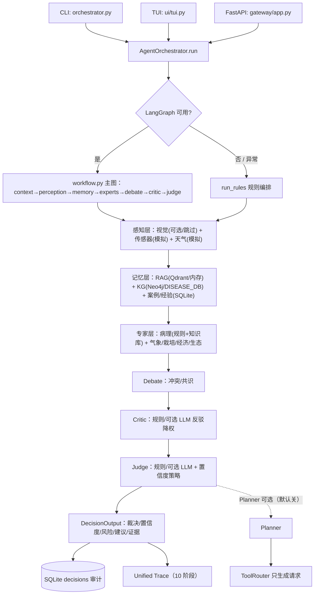

# Agri AI（ACIS）

分层农业认知智能系统原型（Agricultural Cognitive Intelligence System，ACIS）。当前版本为 **ACIS 2.1E（Evidence Platform）**，
由 Planner / Tool Router / 感知 / 记忆 / 专家 / Debate / Critic / Judge 分层协作组成，默认经 LangGraph 主图执行；
LangGraph 不可用或执行失败时自动回退规则编排。

主图流程：`context → perception → memory → experts → debate → critic → judge`（含多轮辩论条件循环 `rebuttal`）。

## 项目解决的问题

温室/大棚种植者在病害早期缺少"可解释、可追溯"的诊断与处置建议：只看单一模型输出，
很难知道结论依据了哪些传感器/天气/知识库证据，也不清楚何时应当弃权或转人工。
ACIS 把一次问诊拆成可审计的多阶段流程，输出**诊断 + 置信度 + 风险 + 行动建议 + 证据链**，
并在外部模型不可用时自动回退到确定性规则链路。

## 系统能力与适用范围

**能做（MVP 范围）**
- 自然语言病害咨询：番茄（叶霉病/早疫病）为主，知识库另含黄瓜霜霉病、甜菜褐斑病/根腐病、棉花黄萎病/枯萎病；
- 输出首选诊断、置信度、风险等级、是否需人工复核、6 条行动建议、辩论共识/冲突、KG 校验、推理摘要；
- 三个入口：CLI、TUI（6 个演示场景）、FastAPI（诊断/历史/反馈/结果回灌）；
- 离线运行：无 API key、无 Neo4j/Qdrant 也能跑；可选接入 Qdrant/Neo4j 与真实 LLM Judge；
- 统一 Trace（10 阶段）、SQLite 决策审计、故障分类与自动回退。

**不能做 / 不在范围**
- 不做真实田间诊断、不替代农技专家；传感器/天气为**模拟数据**；
- 图片识别默认 mock（可选真实模型但未验证质量）；
- 不自动执行施药/灌溉（Tool Router 只生成请求，不执行工具）；
- 未验证生产并发、SLA、跨作物泛化。

## 架构与关键数据流



关键数据流：`用户输入 → 上下文解析 → 感知/记忆/专家证据 → Debate/Critic → Judge → 决策落库 + Trace`。
`need_human_review` 在低置信、冲突、Critic escalate、KG 硬约束冲突时置真；人工反馈通过
`/decisions/{id}/feedback`、`/outcome` 回灌，影响后续案例/经验回放。

## 技术栈

Python 3.13 / LangGraph（主图，失败回退规则）/ OpenAI-compatible SDK（可选 Judge/Critic）/
FastAPI + Uvicorn / SQLite（标准库）/ rich（TUI）/ Qdrant（可选）/ Neo4j（可选）/ pytest。

## 演示案例

- 主案例：`温室A番茄叶片出现黄斑，叶背有灰色霉层，如何处理？` → 叶霉病、置信度 0.72–0.74、medium、6 条建议；
- 冲突案例：`温室A番茄叶背灰色霉层，今天需要浇水吗？要兼顾病害风险` → Debate/Critic 降权；
- 演示脚本与异常处理见 [docs/DEMO_RUNBOOK.md](docs/DEMO_RUNBOOK.md)（3–5 分钟）。

## 验收与材料

- 端到端验收记录：[reports/acceptance_20261024.md](reports/acceptance_20261024.md)
- 最终交付判定：[reports/delivery_verdict_20261024.md](reports/delivery_verdict_20261024.md)
- 实验与指标审计：[reports/experiment_audit_20261024.md](reports/experiment_audit_20261024.md)
- 技术展示材料（架构/流程/请求示例/结果表/故障记录）：[docs/PORTFOLIO.md](docs/PORTFOLIO.md)
- 简历项目描述：[docs/RESUME_ACIS.md](docs/RESUME_ACIS.md)

## 最小可交付版本（2026-10-24）

当前仓库按"可运行、可演示、可验证"的最小交付版本维护。产品代码沿用 ACIS 2.1E 分层链路，
不再以补齐 Phase / 通用智能体架构为目标。

| 项目 | 状态 |
|---|---|
| 主场景 | **温室番茄病害诊断与处置建议**（文本输入；4 作物 / 7 病害知识库；黄瓜保留兼容） |
| 运行基线 | Python 3.13（`.venv`）；CLI / TUI / FastAPI 三入口；无 Neo4j / Qdrant / API key 也可离线运行 |
| 单元测试 | 24 个测试文件 / **343 用例**；普通环境应全绿；沙箱/受限环境中 `tmp_path` ACL 与子进程管道会导致已知错误（见"测试与评估"） |
| 回归 | `evals/smoke_eval.py`（3 套 × 3 场景，LLM Judge 套件在无 key 时回退规则）、`evals/fixture_eval.py`（12 场景） |
| 固定评测 | `scripts/run_delivery_eval.py` → `reports/delivery_eval/summary.{json,md}`（12 例离线确定性评测，已提交） |
| 可观测性 | 统一 Trace 10 阶段；CLI `--trace-out` 可导出；SQLite 决策审计；API 返回 `trace_id` |
| 已知限制 | 图片识别为 mock/可选模型（字段已修复，离线不下载模型）；LLM Judge/Critic 为可选增强；Docker 未在本环境验证；Phase 4/6 指标仅供研究记录 |

> 下文 Sprint/Phase 章节是历史记录，保留用于追溯；交付验收以本节与
> `reports/acceptance_20261024.md`、`reports/delivery_eval/`、`docs/DEMO_RUNBOOK.md` 为准。
> 历史实验的指标口径混用，引用前请先读 `reports/experiment_audit_20261024.md`。

## 版本演进

### ACIS 2.1E — Evidence Platform（2026-07-28 ~ 2026-08-02）

- **Sprint 01 — Unified Trace**：`trace/` 统一追踪层（collector / exporter / types），全链路可观测。
- **Sprint 02 — Evaluation Runner**：`evals/runner.py` + `metrics.py` + `report.py` + `config.py`，9 项指标（accuracy / average_confidence / average_runtime / planner_usage / tool_usage / memory_hits / debate_rounds / counterfactual_count / collective_omission_count）。
- **Sprint 03 — Benchmark Framework**：`benchmarks/` 9 个数据集（难度分层 + 五类能力套件 + enriched 挑战集）。
- **Sprint 04 — Ablation Framework**：`evals/ablation.py`，基线（all_on）对比关闭 Planner / Debate / Memory / Counterfactual / Tool Router / Critic 的模块贡献消融。
- **Sprint 04.5A — Capability Framework**：`benchmarks/capabilities.py` 定义 7 种稳定认知能力枚举；`capability_matrix.py` 自动生成 `CAPABILITY_COVERAGE.md` 与 `CAPABILITY_ANNOTATION_SUGGESTIONS.md`。
- **Sprint 04.5B — Verifiable Capability Contract**：`observable_evidence`（`capability` / `expected_behavior` / `success_condition`）数据契约；36/36 能力案例 + 16/28 难度案例显式标注；`CAPABILITY_CONSISTENCY_REPORT.md`（52/52 一致）；enriched 新增 3 个 `information_gathering` 案例（15→18）。
- **Sprint 04.5C — Capability Evaluation Engine**：`evals/capability_metrics.py` 将能力契约接入运行时——7 种能力全部由 Trace 自动打分（0/1），写入 `CaseMetrics.capability_scores`、`metrics.csv` 能力列与 `summary.md` 的 “Capability Performance”；消融联动验证（`--planner-off` → `information_gathering`/`multi_step_planning` 归零，`--memory-off` → `knowledge_retrieval` 归零）。
- **Sprint 05 — Experiment Manager**：`experiments/`（manager / schema / catalog / archive / analysis / figures），YAML 实验定义、多 seed 运行、`config.yaml` / `manifest.json` 可复现归档、`list` / `compare` / `latest` CLI（详见 `docs/EXPERIMENT_MANAGER_SPRINT_05_REPORT.md`）。
- **Sprint 06 — Research Evaluation Infrastructure**：`experiments/analysis.py` + `figures.py` 统计检验（bootstrap 置信区间）与论文图；归档新增 `dataset_sha256` 指纹、`analysis.json`、`figures/`（详见 `docs/RESEARCH_EVAL_SPRINT_06_REPORT.md`）。

### Phase 4 — Challenge Set 评测战役（2026-08-09 ~ 2026-08-31）

针对"架构是否带来真实能力增量"的问题，建立 Challenge Set v1（24 案例，5 类挑战）并做多轮评测。
> 口径提示：本节为历史记录；Phase 4.1/4.2 与 R3 报告中的 "accuracy" 在部分报告中指 factor coverage
> （见 `scripts/generate_stability_report.py:66-75`），**不是诊断准确率**；引用前先读
> `reports/experiment_audit_20261024.md`。

- **Phase 4.1 pilot（2026-08-09）**：3 configs × 24 cases = 72 calls；accuracy C0 0.5611 / C1 0.5451 / C2 0.5062；仅 ECE C1 略优（0.4571）。
- **Phase 4.2 验证（2026-08-10）**：3 seeds（42/43/44）× 3 configs × 24 cases = 216 calls；C1/C2 相对 C0 弃权率下降（41/33/31）、平均置信度上升（0.39/0.50/0.52），但 accuracy 未显著改善；1 条 malformed output。
- **Phase 4.2-R 真实 Agent（2026-08-12）**：216 次真实链路执行中 191 次 judge 回退 rules（`APIConnectionError`）；R2 诊断定位为端点/连接性配置不一致（`reports/phase4_2_real_agent/diagnosis_judge_fallback.md`）。
- **R3 稳定性（2026-08-16/17，rule-engine coherence judge）**：C0 accuracy 0.3623±0.1624 > C1 0.2799±0.1505、C2 0.2975±0.1247；排名跨 seed 翻转（seed42 C0>C2>C1；seed43 C1>C0>C2；seed44 C2>C1>C0）。
- **R3 压力测试（2026-08-13）**：C1 / seed 42 / `amb_tomato_mold_blind_leaf` 30/30 PASS（单次 87.7–369.5s，均值 179.8s）。
- **R4 预检（2026-08-30）**：harness 与真实 Agent 决策对比 **FAIL**（C0 置信度偏移 0.320、C2 0.750 且标签为 ABSTAIN vs 叶霉病）。

**当前结论**：现有证据**不支持**"完整 ACIS 架构优于裸基线"；需架构师在 Phase 5（扩展评测、补足证据）与 Phase 6（架构重设计）之间做决策，决策前先解决 judge 端点配置、harness/真实一致性、评分口径三项。
### ACIS 2.1（2026-07-25）

- Planner（`planner/`：任务分解、工具调用规划）
- Tool Router（`tool_router/`：Agent → 工具统一路由与权限）
- Meta-Critic（级联错误检测）
- Procedural Memory（经验回放）
- LangGraph 工作流扩展

### ACIS 2.0 认知进化版（2026-07）

- 反事实推理 + Judge 集体忽略检测（争议分 +0.2、置信度下调）
- 多轮辩论：`workflow.py` 主图 `rebuttal` 条件循环，`AGRI_AI_MULTI_ROUND_DEBATE=0` 可关闭
- 经济 Agent / 生态 Agent（成本-收益、农药-天敌冲突检测）
- 置信度校准（`utils/confidence_calibration.py`，Isotonic Regression / Platt Scaling，`AGRI_AI_CALIBRATION=0` 可关闭）
- KG 进化（`propose_triple()` 幂等写入 `data/kg_drafts.json`）+ 经验回放闭环（`POST /decisions/{id}/outcome`）
- 阶段三（P2，远期）预测增强未实施：Chronos/statsmodels 时序预测、传感器异常第三层、`prediction_uncertainty` 字段

## 目录

- `orchestrator.py`：主编排入口（默认 LangGraph 主图，失败回退规则编排）
- `workflow.py`：LangGraph 主图节点定义（含多轮辩论条件循环）
- `planner/`：Planner（任务分解、工具编排）
- `tool_router/`：Tool Router（工具注册与路由）
- `trace/`：Unified Trace（统一追踪采集与导出）
- `agents/`：感知（视觉/传感器/天气）、记忆（RAG/KG/案例/经验回放）、专家（病理/气象/栽培/经济/生态）、Judge
- `debate/`：Debate 协调器 + Critic 反驳轮次
- `rag/`：知识库（Qdrant 可选，默认内存回退）
- `kg_adapter.py` + `kg/`：知识图谱适配器 + AgriKG MCP Server
- `rule_engine/`：传感器异常检测（sensor_anomaly MCP）
- `storage/`：SQLite 持久化（决策审计 + 反馈/结果回灌）
- `gateway/`：FastAPI 路由入口
- `ui/`：TUI + Web UI
- `evals/`：smoke_eval / fixture_eval / runner / ablation / capability_metrics / report
- `experiments/`：实验管理器（Sprint 05/06：YAML 定义、多 seed 运行、统计分析与论文图）
- `benchmarks/`：基准数据集（64 案例）、能力枚举、覆盖/一致性报告（自动生成）
- `context/`：Sprint 状态、路线图、架构状态、已知债务（实现入口，先读 `CURRENT_SPRINT.md`）
- `docs/`：宪法（`ACIS.md`）、RFC、ADR、Sprint 报告
- `results/`：评测产物（summary / suites / ablation / traces / experiments，gitignored）
- `utils/`：置信度校准、集体遗漏分析
- `.venv`：项目 Python 3.13 虚拟环境（运行时 + 开发依赖已装）

## 环境准备（干净环境）

```powershell
# 1) 创建虚拟环境（仓库不提交 .venv）
python -m venv .venv
.\.venv\Scripts\Activate.ps1          # Linux/macOS: source .venv/bin/activate

# 2) 安装依赖。精确复现用锁文件；日常开发用 requirements.txt
pip install -r requirements-lock.txt

# 3) 可选配置：复制模板后按需填写；不填也能离线跑规则链路
Copy-Item .env.example .env

# 4) 运行前设置（Windows PowerShell）
$env:PYTHONIOENCODING='utf-8'
$env:PYTHONPATH='.'
$env:NO_PROXY='localhost,127.0.0.1'   # 系统代理会劫持 localhost 时必设
```

- 核心文本链路不需要 API key、Neo4j、Qdrant；真实 LLM Judge/Critic 需要 `.env` 中的
  `AGRI_AI_JUDGE_API_KEY`（或 `DEEPSEEK_API_KEY`），配置说明见 `.env.example`。
- 依赖锁定文件 `requirements-lock.txt` 由当前验证环境 `pip freeze` 生成；若只装核心依赖，
  可改用 `requirements.txt`（含可选 ML 依赖）。`ruff` / `mypy` 为开发工具，非运行必需。

## 运行

```powershell
$env:PYTHONIOENCODING='utf-8'
$env:PYTHONPATH='.'

# 无参数：内置 2 个演示问题
python orchestrator.py

# 真实业务输入（默认 LangGraph 主图 + 规则 Judge；失败自动回退规则编排）
python orchestrator.py "温室A番茄叶片黄斑，叶背有灰色霉层，如何处理？"

# 仅规则编排；导出统一 Trace；固定随机种子（演示/评测可复现）
python orchestrator.py --rules-only --trace-out logs/trace_demo.json --seed 7 "温室A番茄叶片黄斑，叶背有灰色霉层，如何处理？"

# JSON 输出（含 trace_id / trace_stages）
python orchestrator.py --json "温室A番茄叶片黄斑，叶背有灰色霉层，如何处理？"
```

`--trace-out` 输出的 JSON 包含 `trace_id`、10 个阶段 payload 与有序 `events`，可直接用于
演示中的"证据追溯"；`--json` 输出在原有 decision 字段上增量增加 `trace_id` / `trace_stages`
（兼容旧字段）。

## Docker 快速部署（一键启动）

需要 Docker Desktop（Windows / macOS）或 Docker Engine（Linux），首次构建约 2~5 分钟（轻量镜像，不含 ML 可选依赖）。

```powershell
# Windows
.\start.ps1            # 构建 + 启动 api/qdrant/neo4j + 等待健康检查
.\start.ps1 status     # 查看服务状态
.\start.ps1 logs       # 跟踪 API 日志
.\start.ps1 stop       # 停止（保留数据卷）

# Linux / macOS
./start.sh start
./start.sh import      # 可选: 导入真实 AgriKG 图谱到 Neo4j
./start.sh stop
```

- 启动后 API 位于 `http://localhost:8000`（`GET /health`、`POST /diagnose`），Neo4j 控制台 `http://localhost:17474`（`neo4j / agriai2026`）。
- 启用 LLM Judge / Critic：启动前设置 `$env:DEEPSEEK_API_KEY='sk-...'`（或 `export`），compose 自动透传。
- 镜像基于 `requirements.docker.txt` 的**轻量核心依赖**：torch / transformers / scikit-learn 未打包（视觉推理、Isolation-Forest 异常检测自动降级为模拟/阈值模式）。需要完整能力时改用 `requirements.txt` 构建。
- 真实 AgriKG 导入：将 `Agriculture_KnowledgeGraph-master` 解压到 `data/` 后运行 `.\start.ps1 import`；未导入时 Judge 自动使用内置 DISEASE_DB，离线可跑。
- 常用 docker 命令：`docker compose ps` / `docker compose down -v`（清空数据卷）。

## TUI 演示界面（面试演示）

交互式终端界面（基于 rich），自动加载 DeepSeek Key 与 Neo4j 连接，离线可跑：

```powershell
$env:PYTHONIOENCODING='utf-8'
$env:PYTHONPATH='.'
python -m ui.tui
```

- 内置 **6 个演示场景**（番茄 / 甜菜 / 棉花 × 诊断 / 灌溉 / 预警），覆盖 RAG 命中、KG 一致性校验、Critic 多轮反驳降权。
- `[j]` 切换 DeepSeek Judge（KG 锚定结构化裁决），`[c]` 切换 Critic LLM 反驳；`[6]` 自定义输入。无 Key 或网络失败时自动回退规则模式。
- 首次启动预热传感器异常检测模型约 10s；预热后单次规则决策约 1.4–2.7s（视是否触发第二轮辩论）。
- 未启动 Neo4j / Qdrant 时自动回退内存知识库，TUI 自动设置 `NEO4J_PASSWORD=agriai2026` 与 `HF_HUB_OFFLINE=1`（避免 Chronos 联网下载超时）。

当前支持作物：番茄 / 甜菜 / 棉花（病害与农事指南已内置；黄瓜保留兼容）。

启用 DeepSeek 结构化 Judge（无 Key 或调用失败时自动回退规则裁决）：

```powershell
$env:DEEPSEEK_API_KEY='你的 key'
python orchestrator.py --llm-judge "温室A番茄叶片黄斑，叶背有灰色霉层，如何处理？"
```

启用 DeepSeek 结构化 Critic 反驳（冲突时用 LLM 裁决降权，无 key 或失败时回退规则反驳）：

```powershell
python orchestrator.py --llm-critic "温室A番茄今天需要浇水吗？如果有病害风险要一起考虑"
python orchestrator.py --llm-judge --llm-critic "温室A甜菜叶片圆形褐色病斑，如何处理？"
```

可选环境变量（完整模板见 `.env.example`）：

- `AGRI_AI_JUDGE_API_KEY` / `AGRI_AI_JUDGE_BASE_URL` / `AGRI_AI_JUDGE_MODEL` / `AGRI_AI_JUDGE_PROVIDER`：
  Judge 配置，优先于 `DEEPSEEK_*`；`AGRI_AI_JUDGE_TIMEOUT_SECONDS`（默认 60，最大 300）、
  `AGRI_AI_JUDGE_MAX_RETRIES`（默认 2，最大 5）、`AGRI_AI_JUDGE_SELF_CONSISTENCY_K`（默认 3，1 关闭）
- `DEEPSEEK_API_KEY` / `DEEPSEEK_BASE_URL` / `DEEPSEEK_MODEL`：兼容别名；`AGRI_AI_CRITIC_MODEL`：Critic 模型
- `AGRI_AI_MULTI_ROUND_DEBATE`：多轮辩论开关（默认 1）；`AGRI_AI_EXTRA_EXPERTS`：经济/生态 Agent 开关（默认 1）
- `AGRI_AI_MEMORY_GATE` / `AGRI_AI_MEMORY_GATE_MIN_CONF`：记忆相关性门控（默认开 / 0.45）
- `AGRI_AI_PERSIST`：SQLite 持久化开关（默认 1）；`AGRI_AI_DB_PATH`：审计库路径（默认 `data/agri.db`）
- `ACIS_ENABLE_PLANNER`：启用 Planner（默认 0；Planner 在 Judge 之后运行，Tool Router 不执行工具）
- `AGRI_AI_RAG_BACKEND` / `QDRANT_URL` / `QDRANT_COLLECTION` / `AGRI_AI_RAG_TOP_K`：RAG 后端
- `AGRI_AI_KG_BACKEND` / `NEO4J_URI` / `NEO4J_USER` / `NEO4J_PASSWORD`：KG 后端
- 若使用 opencode 网关：代码**不直接读取** `OPENCODE_*`，需把 `OPENCODE_BASE_URL`/`OPENCODE_API_KEY`
  分别映射到 `AGRI_AI_JUDGE_BASE_URL`/`AGRI_AI_JUDGE_API_KEY`（验收中的真实调用即按此方式配置）
- `HF_HUB_OFFLINE` / `TRANSFORMERS_OFFLINE`：置 1 避免视觉模型联网；`AGRI_AI_VISION_MODE=mock` 强制 mock

## 测试与评估

```powershell
# 单元测试（343 用例 / 24 个测试文件；pytest.ini 已将收集范围限定到 tests/）
python -m pytest -q

# 轻量回归：主图 / 规则 / LLM Judge 回退（3 套 × 3 场景；无 key 时第三套回退规则）
python evals/smoke_eval.py

# 固定场景回归（12 个确定性 crop/intent/病害 断言）
python evals/fixture_eval.py

# 最小交付评测（离线、确定性；生成 reports/delivery_eval/summary.{json,md}）
python scripts/run_delivery_eval.py

# Benchmark 评测（64 案例；输出含 capability_scores 与 Capability Performance）
python evals/runner.py --dataset benchmarks.datasets.enriched
python evals/runner.py --suite all

# 消融（7 组合，输出 results/ablation/；能力分数随模块开关联动）
python evals/ablation.py --dataset benchmarks.datasets.enriched

# 能力覆盖/一致性/标注建议（自动生成 benchmarks/*.md，勿手写）
python -m benchmarks.capability_matrix

# 实验管理（Sprint 05/06；YAML 定义见 experiments/definitions/）
python -m experiments.manager list --output-root results/experiments
python -m experiments.manager run experiments/definitions/phase2_multiseed.yaml
```

## RAG/Qdrant 记忆层

Qdrant 不可用时自动回退内存知识库：

```powershell
# 可选：启动 Qdrant
docker compose up -d qdrant

# 可选：索引内置病害知识
python -m rag.retriever --index

# 检索冒烟测试
python -m rag.retriever --query "番茄叶背灰色霉层" --crop tomato
```

RAG 环境变量：

- `AGRI_AI_RAG_BACKEND`：默认 `auto`，可选 `auto|qdrant|memory`
- `QDRANT_URL`：默认 `http://localhost:6333`
- `QDRANT_COLLECTION`：默认 `agri_knowledge_v1`
- `AGRI_AI_RAG_TOP_K`：默认 `3`

> **Windows 排障**：若本机存在系统代理（如 Clash `127.0.0.1:7892`），httpx 会劫持
> localhost 请求导致 Qdrant/本地服务返回 502（RAG 静默回退内存）。运行前设置
> `$env:NO_PROXY='localhost,127.0.0.1'`（`start.ps1` / `start.sh` 已自动处理）。

## KG/Neo4j 知识图谱

Neo4j 不可用时自动回退内置病害库 DISEASE_DB：

```powershell
# 查看 KG 后端状态
python kg_adapter.py --status

# 检索冒烟测试
python kg_adapter.py --crop tomato --query "叶片黄斑，叶背灰色霉层"
```

KG 环境变量：

- `AGRI_AI_KG_BACKEND`：默认 `auto`，可选 `auto|neo4j|memory`
- `NEO4J_URI`：默认 `bolt://localhost:7687`
- `NEO4J_USER` / `NEO4J_PASSWORD`：默认 `neo4j` / `neo4j`；本项目 docker-compose 的 Neo4j 密码为 `agriai2026`（CLI 运行需 `$env:NEO4J_PASSWORD='agriai2026'`）

> 真实 AgriKG 数据需先用 `scripts/import_agrikg.py` 导入 Neo4j；未导入或未启动时 Judge 自动使用 DISEASE_DB 合成的三元组与硬约束，离线可跑。

## API

```powershell
uvicorn gateway.app:app --reload
```

- `GET /health`
- `POST /diagnose`
- `GET /decisions` / `GET /decisions/{id}`
- `POST /decisions/{id}/feedback`（人工复核标记）
- `POST /decisions/{id}/outcome`（ACIS 2.0 经验回放：有效 / 无效 / 部分有效）

## 相关文档

- `context/ARCHITECTURE_STATE.md`：模块冻结状态（单一真相源）
- `context/ROADMAP.md` / `context/CURRENT_SPRINT.md`：Sprint 路线图与当前 Sprint
- `context/KNOWN_DEBT.md`：已知技术债务
- `docs/ACIS.md`：项目宪法
- `docs/rfc/RFC001-System Architecture.md`：架构权威文档（RFC-001）
- `benchmarks/README.md`：基准框架说明
