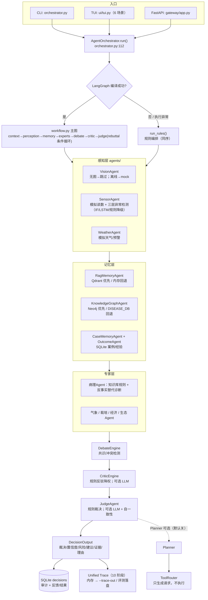
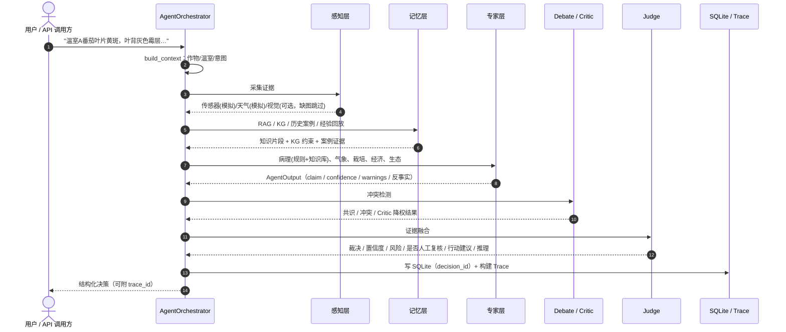

# ACIS 技术展示材料（基于实际实现，2026-10-24）

> 所有图、命令与数字均对应仓库当前代码 / 实测记录；不含虚构用户规模、性能提升或生产经验。
> 相关记录：[验收报告](../reports/acceptance_20261024.md) · [实验审计](../reports/experiment_audit_20261024.md) · [演示脚本](DEMO_RUNBOOK.md)

---

## 1. 系统架构图（与代码一致）



**读图要点**
- 主链默认 LangGraph；编译/执行失败自动回退规则编排（`orchestrator.py:140-151`）。
- Planner/ToolRouter 默认关闭（`ACIS_ENABLE_PLANNER=0`），且在 Judge 之后运行；Router 从不执行工具。
- Trace 在决策完成后构建；CLI `--trace-out` 或评测 `--save-traces` 才落盘。
- 外部依赖全部有内存/规则回退；核心文本链无 API key 可跑。

---

## 2. 核心业务流程图（一次问诊）



**人工复核边界**：系统只给建议，不执行施药/灌溉；`need_human_review` 在低置信、专家冲突、
Critic escalate、KG 硬约束冲突时置真；人工反馈写入 `feedback/outcome` 后供后续案例/经验召回。

---

## 3. 代表性请求与输出

### 3.1 请求（CLI，离线规则链路）

```powershell
$env:PYTHONIOENCODING='utf-8'; $env:PYTHONPATH='.'
python orchestrator.py --rules-only --seed 7 --trace-out logs/trace_demo.json "温室A番茄叶片出现黄斑，叶背有灰色霉层，如何处理？"
```

### 3.2 实际输出（节选，2026-10-24 实测）

```text
【裁决】病理判断首选：番茄叶霉病
【Judge】rules
【置信度】72%
【风险等级】medium
【人工复核】否

【Debate 共识】病理诊断与记忆层（RAG/历史案例）结论一致，诊断可信度升高
【缺失证据】缺少有效图像证据，视觉 Agent 未参与确认
【裁决推理】KG参照疾病：番茄叶霉病、番茄早疫病、番茄褐斑病、番茄黑斑病；
未触发KG硬约束否决；风险等级=medium，置信度=0.72；集体漏检预警…
【行动建议】1) 对异常传感器复测… 2) 围绕最高匹配病害核对关键症状…
【Trace】4c0e91f7... | 10 stages | events=19
```

- `logs/trace_demo.json`（或 `--json`）包含：`trace_id`、10 个阶段 payload、有序 `events`、`judge_runtime`。
- 同一条决策在 SQLite `decisions` 表中有 `decision_id`，可经 `GET /decisions/{id}` 查回。

### 3.3 真实 LLM Judge 单次受控调用（2026-10-24）

- 通道：opencode zen gateway / `deepseek-v4.1-flash`，`k=1`、timeout 30s、retries 0；
- 结果：**成功**，`judge_mode=deepseek`，耗时 34.56s，token 10,354；
- 输出：`番茄叶霉病（黄枝孢霉 Fulvia fulva）——高疑似，但环境硬约束不满足，需人工/镜检复核后方可定论`，confidence 0.3815；
- 说明：这是"真实服务连通"验证，不是质量评测；未做多 seed/多 prompt。

---

## 4. 测试与实验结果表

| 项目 | 命令 | 结果 | 说明 |
|---|---|---|---|
| 交付契约测试 | `pytest -q tests/test_delivery_contract.py`（沙箱 ACL shim） | **12 passed** | 正常/回退/接口契约 |
| 全量测试（受限环境近似） | `pytest -q -p tmpshim` | **3 failed, 340 passed** | 3 个失败为沙箱禁止子进程管道，非业务失败 |
| 全量测试（沙箱原样） | `pytest -q` | **1 failed, 286 passed, 56 errors** | 56 errors 为沙箱 `tmp_path` ACL；普通环境未实测 |
| smoke | `python evals/smoke_eval.py` | exit 0 | 3 套×3 场景 |
| fixture | `python evals/fixture_eval.py` | exit 0，12/12 | 2 例 Critic 触发 |
| 离线交付评测 | `python scripts/run_delivery_eval.py` ×2 | 12/12 命中、2 例 Critic、平均置信度 0.6583；两次哈希一致 | 零 API、固定 seed |
| API | TestClient `/health`、`/diagnose` | 200 / 200 | 返回 decision/judge_mode/trace_id/10 stages/decision_id |
| 故障注入 | 假 key + `127.0.0.1:9` + `--llm-judge` | exit 0；`connection_error`、`retry_exhausted=true` | 自动回退 rules，密钥不泄漏 |
| 视觉离线 mock | `HF_HUB_OFFLINE=1` + 临时图 | 番茄叶霉病 / 0.87 | 修复字段 + 离线不下载模型 |
| 真实 LLM 单次 | opencode / `deepseek-v4.1-flash` | success / 34.56s / 10,354 tokens | 仅连通性验证 |

**实验结论（详见实验审计）**：Phase 6 baseline seed42 72/72 调用成功；C0 20/24、C1 19/24、C2 24/24；
单 seed、n=24，**不能证明架构收益**；Phase 4.2-R 191/216 为规则回退，其报告 "accuracy" 是 factor coverage。

---

## 5. 关键故障定位与修复记录

| # | 现象 | 根因 | 修复 | 验证 |
|---|---|---|---|---|
| 1 | 按 README 跑 `pytest -q` 直接收集中断（31 collection errors） | 无 `pytest.ini`；根目录 `pytest-of-lkl/` 权限不可读、`logs/.../clean/tests` 被递归收集 | 新增 `pytest.ini`：`testpaths=tests` + `norecursedirs`；README 改命令 | 收集错误消失；全量只剩沙箱 ACL/管道错误 |
| 2 | 上传图片永远"未知类别"，且离线时卡住 >120s | `vision_agent.py:20` 读 `top_prediction`，`vision.py:155` 实际返回 `diagnosis`；`_get_classifier` 在 transformers 已安装时尝试 HF 下载 | 兼容解析 `diagnosis`；离线/`AGRI_AI_VISION_MODE=mock` 直接走 mock | 离线 mock 返回"番茄叶霉病/0.87"，<2s |
| 3 | 统一 Trace 只在进程内，演示无法追溯；持久化/LangGraph 失败静默 | Trace 无出口；`_persist` `except: pass`；LangGraph 回退只写一句文本 | CLI `--trace-out` + `--json` 增量 `trace_id/trace_stages`；两处加 WARNING 日志 | trace JSON 10 阶段/19 事件；故障注入可见原因；单测覆盖 |
| 4 | API 异常裸 500、响应无法追溯到 Trace | `gateway/app.py` 无异常边界；只返回 decision 字段 | 异常转结构化 500；响应增 `trace_id/trace_stages`；`/health` 增 `judge_configured` | TestClient 200/500 契约测试 |
| 5 | 自一致性采样失败只计数、不分类 | `_sample_self_consistency` 宽泛 `except` | 用 `classify_failure` 分类 + WARNING + `failure_codes` | 代码审查 + 故障路径单测 |

---

## 6. 3–5 分钟演示流程

完整命令见 [DEMO_RUNBOOK.md](DEMO_RUNBOOK.md)，时间轴：

| 时间 | 内容 | 展示点 |
|---|---|---|
| 0:00–0:30 | `python -m ui.tui` 启动 | 6 场景菜单、状态条（Judge/KG/RAG） |
| 0:30–1:40 | 场景 1 番茄叶霉病诊断 | Agent 轨迹、最终裁决、置信度、行动建议 |
| 1:40–2:30 | 场景 2 灌溉 vs 病害冲突 | Debate/Critic 降权 |
| 2:30–3:20 | 证据追溯 | TUI KG 分析；CLI `--trace-out` + trace_id/10 stages |
| 3:20–4:10 | 异常处理 | 假端点 `--llm-judge` → fallback 原因/日志 |
| 4:10–4:40 | 收尾 | API `/diagnose` 或 SQLite decision_id |

**演示前**：设置 `NO_PROXY`、`HF_HUB_OFFLINE=1`；无 key 默认规则版；有 key 可按 `[j]` 加演 LLM。
